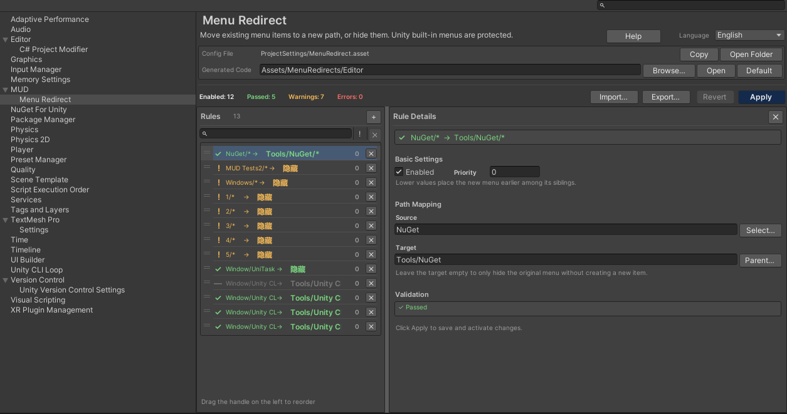

# MUD Menu Redirect

Move or hide existing Unity Editor menu items with project-level rules — without modifying third-party
source code, assets, or package manifests.

## What it does

Unity registers menu items with compile-time `[MenuItem]` attributes. Menu Redirect lets you:

- move a menu item to a new path;
- hide a menu item or an entire branch;
- move all executable children of a container under a new parent;
- keep Unity's built-in menus and official package entries protected.

The original menu is removed through Unity's internal menu API. A generated `MenuItem` wrapper invokes
the original method by reflection, so the redirected entry still works after the original is hidden.

## How it works

1. **Rules are edited in Project Settings.** Rules live in `ProjectSettings/MenuRedirect.asset`.
2. **Apply writes generated wrappers.** The default file is `Assets/MenuRedirects/Editor/MenuRedirects.g.cs`.
3. **Unity compiles the wrappers.** If the wrapper code changed, hiding waits for the compile and domain reload.
4. **The original menus are hidden.** After the reload, the generated menu entries are registered and the originals are removed.
5. **Domain reloads replay hiding.** The bootstrap re-checks that the generated code exists and matches the current rules before hiding anything.

## Feature highlights

- Leaf redirect, hide-only, and branch move.
- Searchable menu picker for source and parent paths.
- Shared validation for the list, detail panel, and Apply button.
- Transactional generated-code updates with rollback.
- Unsaved draft recovery through `Library/MenuRedirectDraft.json`.
- Rule import/export as portable JSON.
- Follow System / 中文 / English editor UI.
- 84 EditMode regression tests.

## Requirements

- Unity 2022.3 LTS or newer.
- Editor-only package; no runtime code is added to builds.
- Git installed when installing through a Git URL.

## Start here

- [Installation](installation.md)
- [Quick Start](quick-start.md)
- [Settings Page](settings.md)
- [Rules & Paths](rules.md)
- [Troubleshooting & FAQ](troubleshooting-faq.md)
