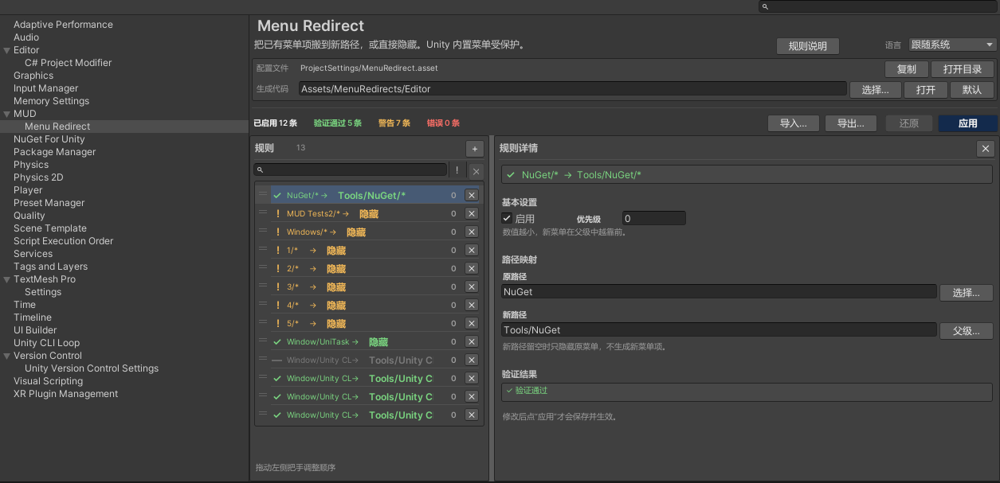

# MUD Menu Redirect

通过项目级规则把已有 Unity 编辑器菜单“搬”到新路径，或直接隐藏；**不修改任何第三方源码、资产或包清单**。

## 它能做什么

Unity 通过编译期 `[MenuItem]` 特性注册菜单。Menu Redirect 可以：

- 把菜单项移动到新路径；
- 隐藏单个菜单或整棵分支；
- 把容器下所有可执行子项搬到新父级；
- 保护 Unity 内置菜单和官方包条目不被移除或搬移。

原菜单通过 Unity 内部菜单 API 移除；生成一个 `MenuItem` 包装方法，通过反射调用原方法，
因此原菜单隐藏后新入口仍然可用。

## 工作方式

1. **在 Project Settings 中编辑规则。** 规则保存在 `ProjectSettings/MenuRedirect.asset`。
2. **应用时生成包装代码。** 默认文件为 `Assets/MenuRedirects/Editor/MenuRedirects.g.cs`。
3. **Unity 编译包装代码。** 如果代码有变化，隐藏会等待编译和域重载完成。
4. **隐藏原菜单。** 重载后生成菜单已注册，原菜单被移除。
5. **域重载后重放隐藏。** Bootstrap 会先确认生成代码存在且与当前规则一致，再执行隐藏。

## 功能亮点

- 叶子重定向、仅隐藏、分支搬移。
- 可搜索的原路径/父级路径选择器。
- 列表、详情面板和应用按钮共享同一份验证结果。
- 生成代码事务写入与失败回滚。
- 通过 `Library/MenuRedirectDraft.json` 恢复未保存草稿。
- 规则 JSON 导入/导出。
- 跟随系统 / 中文 / English 编辑器界面。
- 84 个 EditMode 回归测试。

## 环境要求

- Unity 2022.3 LTS 或更高版本。
- 纯编辑器包，不会向运行时构建添加代码。
- 通过 Git URL 安装时需要本机安装 Git。

## 开始使用

- [安装](installation.md)
- [快速开始](quick-start.md)
- [设置页](settings.md)
- [规则与路径](rules.md)
- [故障排查与 FAQ](troubleshooting-faq.md)
