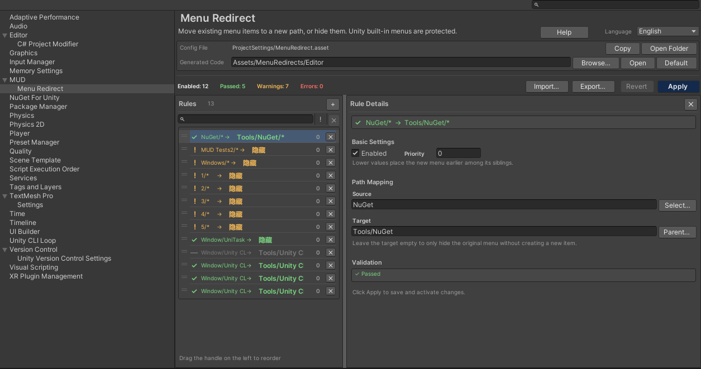

# Quick Start

This walkthrough moves a single menu item to a new path.

## 1. Open the settings page

Open **Edit > Project Settings > MUD > Menu Redirect**, or use **Tools > MUD > Menu Redirect**.

## 2. Add a rule

Click **Add** in the left list. A new disabled rule is created and selected. In the detail panel:

- enable the rule;
- set **Source Path** to the existing menu, for example `NuGet/Manage NuGet Packages`;
- set **Target Path** to the new location, for example `Tools/My Tools/Manage NuGet Packages`;
- leave **Priority** at `0` unless you need to control ordering among siblings.

Use the **Select...** button next to Source Path to pick from the registered menu tree. Use
**Parent...** next to Target Path to choose a parent container.

## 3. Check validation

The row status and the **Validation** panel update after a short debounce.

- Green check: the rule can be applied.
- Yellow warning: the rule can be applied, but something is limited or skipped.
- Red error: Apply is disabled until the error is fixed.

Common errors include an existing target path, a source without an executable static `[MenuItem]`,
overlapping rules, and invalid path syntax.

## 4. Apply

Click **Apply**. The tool:

1. writes the generated wrapper code;
2. saves `ProjectSettings/MenuRedirect.asset`;
3. removes the old generated file if the folder changed.

If the wrapper code changed, Unity recompiles and reloads the domain. The original menu is hidden
after the reload. If the code did not change, hiding happens immediately.

## 5. Verify

Open the target menu. The new entry should be present and should execute the original action.

The original path should be gone. If it is still visible, check the Console for compile errors and
see [Troubleshooting & FAQ](troubleshooting-faq.md).

## Hide instead of moving

Leave **Target Path** empty. The rule becomes a hide-only rule:

- a leaf source hides that menu item;
- a branch source hides the entire branch.

## Next steps

- Learn the four rule types in [Rules & Paths](rules.md).
- Learn the tree picker in [Menu Picker](picker.md).
- Learn what happens during a domain reload in [Apply, Generated Code & Domain Reload](apply-reload.md).
