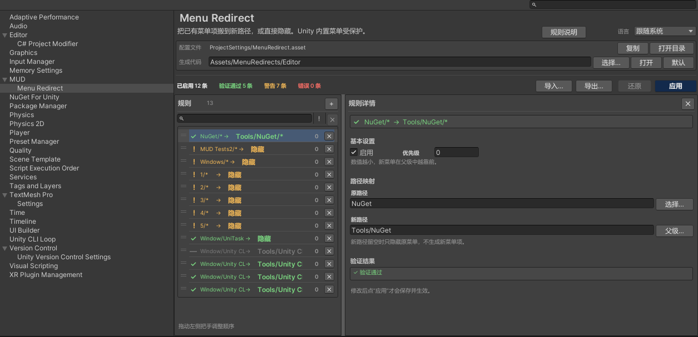

# 快速开始

本教程把单个菜单项移动到新路径。

## 1. 打开设置页

打开 **Edit > Project Settings > MUD > Menu Redirect**，或使用 **Tools > MUD > Menu Redirect**。

## 2. 新建规则

点击左侧列表的 **Add**。会创建并选中一条未启用的规则。在右侧详情中：

- 勾选 **启用**；
- **原路径**填已有菜单，例如 `NuGet/Manage NuGet Packages`；
- **新路径**填目标位置，例如 `Tools/My Tools/Manage NuGet Packages`；
- **优先级**保持 `0`，除非你需要控制同级菜单的排序。

原路径右侧的 **选择…** 可以从已注册菜单树中选择；新路径右侧的 **父级…** 可以选择父级容器。

## 3. 检查验证结果

规则行状态和 **验证结果** 会在短暂防抖后更新。

- 绿色对勾：可以应用。
- 黄色警告：可以应用，但有受保护子项被跳过或只能隐藏等限制。
- 红色错误：应用按钮禁用，必须先修正。

常见错误包括目标路径已存在、原路径没有可执行静态 `[MenuItem]`、规则重叠、路径格式非法等。

## 4. 应用

点击 **应用**。工具会：

1. 写入生成包装代码；
2. 保存 `ProjectSettings/MenuRedirect.asset`；
3. 如果生成目录变化，删除旧位置的生成文件。

如果包装代码有变化，Unity 会重新编译并完成域重载，重载后才隐藏原菜单。
如果代码没有变化，则立即隐藏。

## 5. 验证

打开目标菜单。新条目应该存在，并且能执行原菜单的动作。

原路径应该消失。如果原菜单仍然可见，检查 Console 是否有编译错误，
并查看[故障排查与 FAQ](troubleshooting-faq.md)。

## 只隐藏、不移动

把 **新路径**留空即可：

- 叶子原路径会隐藏该菜单项；
- 分支原路径会隐藏整棵分支。

## 下一步

- 在[规则与路径](rules.md)中了解四种规则用法。
- 在[菜单选择器](picker.md)中了解树形选择器。
- 在[应用、生成代码与域重载](apply-reload.md)中了解应用后的完整流程。
