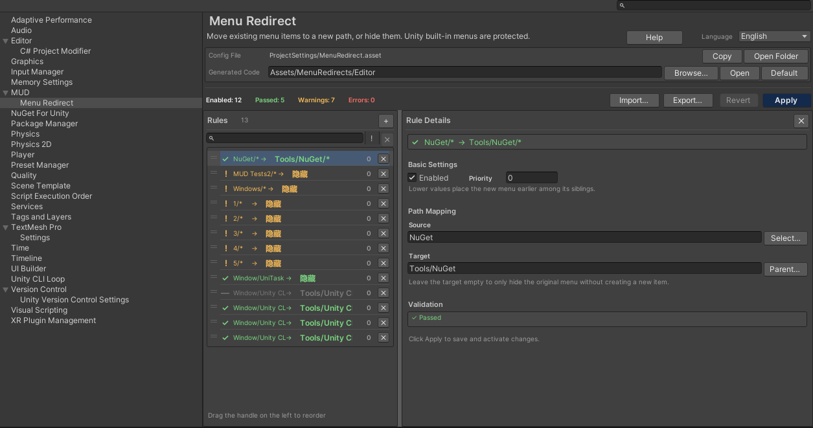

# MUD Menu Redirect

**English** | [简体中文](README.zh-CN.md)

Move or hide existing Unity Editor menu items with project-level rules — without touching third-party source code, assets, or package manifests.

[](https://unity.com/)
[](LICENSE)
[](https://github.com/MUDV587/com.mud.modules.menuredirect)
[](https://github.com/MUDV587/com.mud.modules.menuredirect/releases)



## Why Menu Redirect

Unity menu layouts are often fixed at compile time by `[MenuItem]` attributes. Moving a third-party
tool into your own menu usually means editing its source or maintaining a fork.

Menu Redirect keeps the original code untouched:

- **Rules live in project settings** — one project-level configuration, versionable with the project.
- **Original menus are hidden at runtime** — through Unity's internal menu API, replayed after domain reloads.
- **New entries are generated wrappers** — a generated `MenuItem` file invokes the original method by reflection.
- **Built-in Unity menus are protected** — File / Edit / Assets / GameObject / Window and Unity-owned
  package entries cannot be removed or moved.

## Features

- **Leaf redirect** — move a single menu item to a new path.
- **Hide only** — remove a menu item or an entire branch without creating a replacement.
- **Branch move** — move every executable child of a container under a new parent path.
- **Menu picker** — searchable tree view for source paths and parent paths, with protected-item markers.
- **Shared validation** — the list status, detail panel, and Apply button all use the same validation result.
- **Safe apply** — generated-code writes, config saves, and old-file removal are transactional.
- **Draft recovery** — unsaved edits are debounced to `Library/MenuRedirectDraft.json` and restored after a crash.
- **Import / export** — portable rule-only JSON files for reuse across projects.
- **Bilingual editor UI** — Follow System / 中文 / English, stored per project in `EditorPrefs`.
- **EditMode regression tests** — 84 tests covering rules, validation, generated code, and Unity ownership.

## Requirements

- Unity **2022.3 LTS** or newer.
- **Editor-only** package. It does not add runtime code to builds.
- Git must be installed if you install through a Git URL.

## Installation

### Package Manager

1. Open **Window > Package Manager**.
2. Click **+** in the top-left corner.
3. Choose **Add package from git URL...**.
4. Enter:

```text
https://github.com/MUDV587/com.mud.modules.menuredirect.git#v0.2.1
```

5. Click **Add** and wait for Unity to compile.

### manifest.json

Add this entry to `Packages/manifest.json`:

```json
"com.mud.modules.menuredirect": "https://github.com/MUDV587/com.mud.modules.menuredirect.git#v0.2.1"
```

Pinning a tag is recommended for team projects. Omit `#v0.2.1` to follow the default branch.

## Quick Start

1. Open **Edit > Project Settings > MUD > Menu Redirect** (or **Tools > MUD > Menu Redirect**).
2. Click **Add** in the left list and select the new rule.
3. In the detail panel:
   - Set **Source Path** to the menu you want to move, for example `NuGet/Manage NuGet Packages`.
   - Set **Target Path** to the new location, for example `Tools/My Tools/Manage NuGet Packages`.
   - Keep **Enabled** checked.
4. Click **Apply**.
5. If wrapper code changed, wait for Unity to recompile and reload the domain. The original menu is
   hidden after the reload; the new menu appears in the target location.

To hide a menu without creating a replacement, leave **Target Path** empty.

## Rule Types

| Source path | Target path | Result |
|---|---|---|
| `NuGet/Manage NuGet Packages` | `Tools/My Tools/Manage NuGet Packages` | Leaf redirect |
| `NuGet/Manage NuGet Packages` | *(empty)* | Hide a single menu item |
| `NuGet` | `Tools/My Tools` | Move the whole branch |
| `NuGet` | *(empty)* | Hide the whole branch |

A branch path is either a top-level path without `/` or a container that has registered children but
is not itself registered as a menu item. Paths that are themselves registered with `[MenuItem]` are
treated as leaves.

## Safety and Limits

- Unity built-in menus and Unity-owned package entries are protected. Rules that would remove them
  fail validation instead of changing the editor.
- `Tools` and other third-party/custom roots can be moved or hidden.
- Shortcuts are **not** copied. Unity's `MenuItem` shortcut is a compile-time attribute; the generated
  wrapper cannot reproduce it. The Apply feedback lists affected shortcuts so you can add them manually.
- Dynamically registered menus can be hidden, but not redirected. Redirecting requires a static
  `[MenuItem]` method.
- If generated code fails to compile, hiding is deferred so the original menu is not removed while
  the replacement is unavailable.
- Context menus declared by Unity are protected. Third-party context menus are supported.

## Documentation

- **English documentation**: <https://mudv587.github.io/com.mud.modules.menuredirect/>
- **中文文档**: <https://mudv587.github.io/com.mud.modules.menuredirect/zh/>
- **Design notes**: [Documentation~/Design.md](Documentation~/Design.md)
- **Changelog**: [CHANGELOG.md](CHANGELOG.md)

## Project Files

Commit these files to version control so teammates and CI get the same menu layout:

```text
ProjectSettings/MenuRedirect.asset
Assets/MenuRedirects/Editor/MenuRedirects.g.cs   # or your configured generated folder
```

Do **not** commit `Library/MenuRedirectDraft.json`. It is a local crash-recovery file.

## Development

The package contains EditMode tests under `Tests/Editor`:

```text
Window > General > Test Runner > EditMode > Run All
```

The tests cover rule evaluation, protected-menu detection, generated-code transactions, rule-file
validation, Unity ownership detection, and localization keys.

## Cleanup Before Uninstalling

Run **Tools > MUD > Menu Redirect > Clean Up Generated Files** before removing the package.
The command only deletes `MenuRedirects.g.cs` files with this tool's generated header and keeps
`ProjectSettings/MenuRedirect.asset`.

If the package is already removed, delete the generated file manually and let the next domain reload
restore the original menus. See the [cleanup guide](https://mudv587.github.io/com.mud.modules.menuredirect/cleanup/).

## License

MIT. See [LICENSE](LICENSE).
