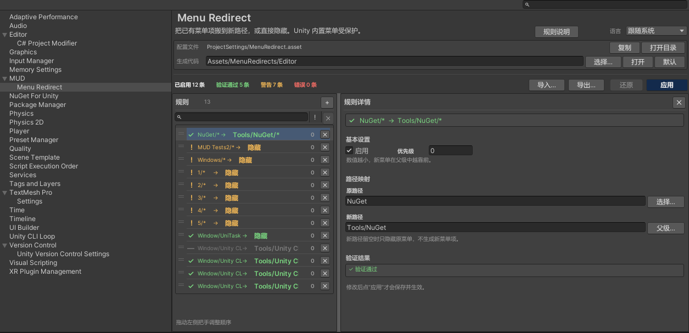

# MUD Menu Redirect

[English](README.md) | **简体中文**

通过项目级规则把已有 Unity 编辑器菜单“搬”到新路径，或直接隐藏；**不修改任何第三方源码、资产或包清单**。

[](https://unity.com/)
[](LICENSE)
[](https://github.com/MUDV587/com.mud.modules.menuredirect)
[](https://github.com/MUDV587/com.mud.modules.menuredirect/releases)



## 为什么需要它

Unity 的菜单布局通常由编译期的 `[MenuItem]` 特性固定。要把第三方工具放进自己的菜单，
一般只能改它的源码或长期维护一个 fork。

Menu Redirect 不需要改原代码：

- **规则保存在项目配置中** —— 一份项目级配置，可随工程提交到版本库。
- **运行时隐藏原菜单** —— 通过 Unity 内部菜单 API 移除，域重载后自动重放。
- **新菜单是生成的包装代码** —— 生成的 `MenuItem` 文件通过反射调用原方法。
- **Unity 内置菜单受保护** —— File / Edit / Assets / GameObject / Window 以及 Unity 官方包条目
  不会被移除或搬移。

## 功能

- **叶子重定向** —— 把单个菜单项移动到新路径。
- **仅隐藏** —— 移除单个菜单或整棵分支，不创建替代入口。
- **分支搬移** —— 把容器下所有可执行子项搬到新父级路径下。
- **菜单选择器** —— 可搜索的树形原路径/父级路径选择器，带受保护条目标记。
- **共享验证** —— 列表状态、详情面板和“应用”按钮使用同一份验证结果。
- **安全应用** —— 生成代码写入、配置保存、旧文件删除按事务顺序执行。
- **草稿恢复** —— 未保存修改防抖写入 `Library/MenuRedirectDraft.json`，崩溃后可恢复。
- **导入/导出** —— 规则专用 JSON 文件，便于跨项目复用。
- **中英文界面** —— 跟随系统 / 中文 / English，语言偏好按项目保存在 `EditorPrefs`。
- **EditMode 回归测试** —— 84 项测试覆盖规则、验证、生成代码和 Unity 归属判定。

## 环境要求

- Unity **2022.3 LTS** 或更高版本。
- **纯编辑器包**，不会向运行时构建添加代码。
- 通过 Git URL 安装时需要本机安装 Git。

## 安装

### Package Manager

1. 打开 **Window > Package Manager**。
2. 点击左上角 **+**。
3. 选择 **Add package from git URL...**。
4. 输入：

```text
https://github.com/MUDV587/com.mud.modules.menuredirect.git#v0.2.0
```

5. 点击 **Add**，等待 Unity 编译完成。

### manifest.json

在 `Packages/manifest.json` 中加入：

```json
"com.mud.modules.menuredirect": "https://github.com/MUDV587/com.mud.modules.menuredirect.git#v0.2.0"
```

团队项目建议固定 tag；去掉 `#v0.2.0` 则跟随默认分支。

## 快速开始

1. 打开 **Edit > Project Settings > MUD > Menu Redirect**（或 **Tools > MUD > Menu Redirect**）。
2. 点击左侧列表的 **Add**，选中新规则。
3. 在右侧详情中：
   - **原路径**填要移动的菜单，例如 `NuGet/Manage NuGet Packages`。
   - **新路径**填目标位置，例如 `Tools/My Tools/Manage NuGet Packages`。
   - 保持 **启用**勾选。
4. 点击 **应用**。
5. 如果本次生成了新的包装代码，等待 Unity 重新编译并完成域重载。重载后原菜单被隐藏，
   新菜单出现在目标位置。

如果只想隐藏、不创建替代入口，把 **新路径**留空即可。

## 规则类型

| 原路径 | 新路径 | 结果 |
|---|---|---|
| `NuGet/Manage NuGet Packages` | `Tools/My Tools/Manage NuGet Packages` | 叶子重定向 |
| `NuGet/Manage NuGet Packages` | *(空)* | 隐藏单个菜单 |
| `NuGet` | `Tools/My Tools` | 搬移整棵分支 |
| `NuGet` | *(空)* | 隐藏整棵分支 |

分支路径指不带 `/` 的顶级路径，或自身未注册为菜单项但有已注册子项的中间容器。
自身已注册 `[MenuItem]` 的路径按叶子处理。

## 安全与限制

- Unity 内置菜单和 Unity 官方包条目受保护；会移除它们的规则在验证阶段直接报错，不会改动编辑器。
- `Tools` 及其他第三方/自定义根菜单可以搬移或隐藏。
- **不会复制快捷键**。Unity 的 `MenuItem` 快捷键是编译期特性，生成的包装无法复现；
  应用成功后的反馈区会列出受影响的快捷键，需要手动补到新菜单。
- 动态注册的菜单可以隐藏，但不能重定向；重定向需要静态 `[MenuItem]` 方法。
- 如果包装代码编译失败，隐藏会暂缓，避免原菜单已移除而新菜单不可用。
- Unity 声明的上下文菜单受保护；第三方上下文菜单支持重定向。

## 文档

- **English documentation**: <https://mudv587.github.io/com.mud.modules.menuredirect/>
- **中文文档**: <https://mudv587.github.io/com.mud.modules.menuredirect/zh/>
- **设计文档**: [Documentation~/Design.md](Documentation~/Design.md)
- **变更日志**: [CHANGELOG.md](CHANGELOG.md)

## 需要提交的文件

为了让团队成员和 CI 得到相同的菜单布局，建议提交：

```text
ProjectSettings/MenuRedirect.asset
Assets/MenuRedirects/Editor/MenuRedirects.g.cs   # 或你配置的生成目录
```

**不要**提交 `Library/MenuRedirectDraft.json`，它是本机崩溃恢复文件。

## 开发与测试

包内测试位于 `Tests/Editor`：

```text
Window > General > Test Runner > EditMode > Run All
```

测试覆盖规则评估、受保护菜单判定、生成代码事务、规则文件校验、Unity 归属判定和本地化键。

## 卸载前清理

移除包之前执行 **Tools > MUD > Menu Redirect > Clean Up Generated Files**。
该命令只删除带本工具生成头的 `MenuRedirects.g.cs`，保留 `ProjectSettings/MenuRedirect.asset`。

如果包已经移除，请手动删除生成文件，并等待下一次域重载恢复原菜单。
详见[清理指南](https://mudv587.github.io/com.mud.modules.menuredirect/zh/cleanup/)。

## 许可证

MIT，见 [LICENSE](LICENSE)。
